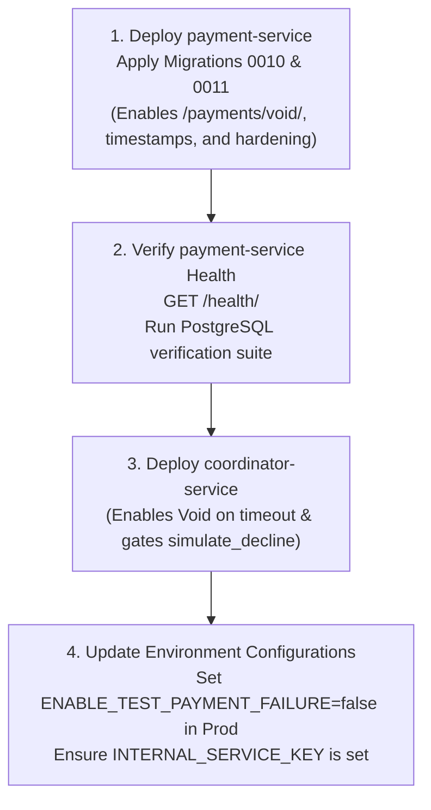

# COORDINATOR SERVICE REQUIRED CHANGES & ROLLOUT PLAN

This document specifies the required adjustments to `coordinator-service` resulting from the `payment-service` security hardening audit, ranked by priority.

---

## 1. Required Coordinator Changes

### Priority 1: Remediate 9999 Underpayment Vector (CRITICAL)
- **Files & Lines**:
  - `coordinator/views.py:895-915` (reserve flow `simulate_decline` acquisition)
  - `coordinator/views.py:975-985` (confirm flow `simulate_decline` acquisition)
  - `coordinator/views.py:1255-1265` (`amount` override check)
- **Existing Vulnerability**:
  Client query parameters (`?simulate_payment_decline=true`) and headers (`X-Simulate-Payment-Decline: true`) allow unauthenticated clients to set `simulate_decline = True`. Lines 1262–1264 then preserve `amount = Decimal('9999.00')` rather than assigning the inventory total:
  ```python
  if amount != Decimal('9999.00'):
      amount = total_amount
  ```
  Since `payment-service` now strictly gates the 9999 failure simulation behind `ENABLE_TEST_PAYMENT_FAILURE=False` (F2), in production 9999 is processed as a real, successful charge. An attacker purchasing \$50,000 of VIP seats who passes `?simulate_payment_decline=true` will only be charged \$9,999.00 and have their entire order confirmed.
- **Proposed Change**:
  1. Gate `simulate_decline` evaluation behind `settings.ENABLE_TEST_PAYMENT_FAILURE`:
     ```python
     simulate_decline = False
     if getattr(settings, "ENABLE_TEST_PAYMENT_FAILURE", False):
         if getattr(settings, "DEBUG", False) or (request.user and request.user.is_staff):
             simulate_decline = request.query_params.get("simulate_payment_decline", "").lower() in ("true", "1")
     ```
  2. In `_charge_payment` (or `_process_booking` / `_confirm_booking`), always derive `amount = total_amount` unconditionally unless `settings.ENABLE_TEST_PAYMENT_FAILURE` is active.
- **Breaking Risk**: `BREAKING IF NOT COORDINATED` (Any test suites relying on client-injected query params without setting `ENABLE_TEST_PAYMENT_FAILURE=True` will no longer decline).

---

### Priority 2: Void Integration on Charge Timeout (HIGH)
- **Files & Lines**:
  - `coordinator/views.py:460-485` (`_compensate_transaction`)
  - `coordinator/management/commands/recovery_stuck_transactions.py:230-250` (`recover_transaction`)
- **Existing Behavior**:
  When a charge request times out, `coordinator` calls `payment_check`. If `payment_check` returns `NOT_CHARGED`, coordinator proceeds directly to compensate inventory (`release_inventory`). However, if the charge request was merely delayed in transit or in the database, it can land *after* `payment_check`, resulting in a phantom charge with released inventory.
- **Proposed Change**:
  Before releasing inventory on charge timeout, invoke the new idempotent endpoint `POST /payments/void/` with `{"transaction_id": str(transaction_id)}`:
  ```python
  void_resp = client.post(
      f"{payment_service_url}/payments/void/",
      json={"transaction_id": str(transaction_id)},
      headers={"X-Internal-Service-Key": internal_service_key},
      timeout=request_timeout,
  )
  if void_resp.status_code == 200:
      data = void_resp.json()
      if data.get("status") == "CHARGED":
          # Charge landed before void tombstone could be written: trigger refund compensation
          was_charged = True
          _refund_payment(transaction_id)
      else:
          # Tombstone active: proceed with safe inventory release
          was_charged = False
  ```
- **Breaking Risk**: `SAFE EXTENSION` (Additive endpoint; falls back gracefully to `payment_check` if not called).

---

### Priority 3: Handle 409 IDEMPOTENCY_PAYLOAD_MISMATCH (MEDIUM)
- **Files & Lines**:
  - `coordinator/views.py:1260-1285` (`_charge_payment` response handling)
- **Existing Behavior**:
  Coordinator checks `response.status_code == 201 or (response.status_code == 200 and response.json().get("status") == "CHARGED")` to determine success. Any other status code is treated as charge failure.
- **Proposed Change**:
  Explicitly handle HTTP 409 with `code == "IDEMPOTENCY_PAYLOAD_MISMATCH"`. Do NOT release inventory immediately; check `payment_check` or void first, and log a critical security/integrity alarm to alert operators of an idempotency key collision or replay attempt with modified values:
  ```python
  if response.status_code == 409 and response.json().get("code") == "IDEMPOTENCY_PAYLOAD_MISMATCH":
      logger.critical(
          "Idempotency conflict detected for transaction %s: %s",
          transaction_id,
          response.json().get("error")
      )
  ```
- **Breaking Risk**: `NONE` (Coordinator already treats non-200/201 as failure; logging improves observability).

---

## 2. Deployment & Rollout Ordering



1. **Service Deployment Order**:
   - **Step 1: Deploy `payment-service` first**.
     Apply migrations `0010_payment_status_voided_and_amount_nullable.py` and `0011_payment_updated_at_refunded_at.py`.
     Both migrations are completely backward-compatible (nullable amount with CheckConstraint, audit timestamps).
   - **Step 2: Deploy `coordinator-service` second**.
     The updated coordinator can now safely call `POST /payments/void/` and rely on hardened state transitions.

2. **Mixed-Version Window Compatibility**:
   - **Safe**. During deployment rollover, if old `coordinator-service` calls new `payment-service`:
     - Existing endpoints (`/payments/charge/`, `/payments/check/`, `/payments/refund/`) preserve exact status codes (201, 200, 400, 404, 409, 422) and JSON response shapes.
     - `payment_check` returns `{"status": "NOT_CHARGED", "voided": true}` which matches coordinator's check for `payment_status == 'NOT_CHARGED'`.
     - Email responses remain unmasked in API payloads per contract (masked only in log output).
